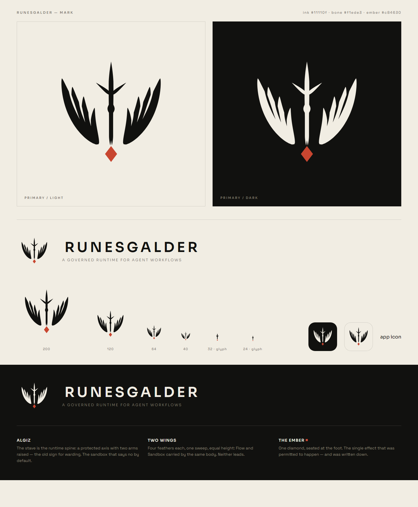

# Brand

The Runesgalder mark is an Algiz stave between two wings, with an ember diamond seated below the foot.

- **The stave** is the runtime spine: one governed axis, its arms raised, drawn as a spear rather than a letterform.
- **The wings** are Flow and Sandbox. Four feathers each, one shared foot, one sweep along the rim, equal height. Neither surface leads.
- **The ember diamond** is the single effect that was permitted to happen, and written down. It is the only coloured element in the mark.



## Files

All paths are relative to `assets/brand/`.

| File | Size | Use |
| --- | --- | --- |
| `crest.svg` | 1000 × 1000, vector | Primary mark on light surfaces. Ink on bone. |
| `crest-dark.svg` | 1000 × 1000, vector | Primary mark on dark surfaces. Bone on ink. |
| `crest-1024.png` | 1024 × 1024, transparent | README header, slides, documents that cannot take SVG. |
| `crest-dark-1024.png` | 1024 × 1024, transparent | The same for dark themes. |
| `lockup-light.png` | 1600 × 400 | Horizontal lockup on light. Crest, name, tagline. |
| `lockup-dark.png` | 1600 × 400 | Horizontal lockup on dark. |
| `icon-512.png` | 512 × 512 | App icon, organisation avatar, package icon. Bone tile. |
| `icon-512-dark.png` | 512 × 512 | The same on an ink tile. |
| `favicon-32.png`, `favicon-16.png` | 32 and 16, transparent | Browser tab. Pre-rendered from the crest; do not redraw at these sizes. |
| `social-1280x640.png` | 1280 × 640 | GitHub social preview. |
| `brand-sheet.png` | 1400 × 1700 | One-page overview: both themes, lockup, size ladder. |

## Colour

| Name | Value | Role |
| --- | --- | --- |
| Bone | `#f1ede3` | Background, and the mark itself on ink. |
| Ink | `#11110f` | The mark on bone; text. |
| Ember | `#c84630` | The diamond, and nothing else. |
| Muted | `#6f695e` | Tagline on bone. |
| Muted dark | `#8b8578` | Tagline on ink. |

## Clear space and minimum size

- Keep at least 10% of the mark's width clear on every side. Nothing overlaps the wings or the diamond.
- Minimum width: 24 px on screen, 12 mm in print. Below 32 px use the pre-rendered favicons; the crest is not simplified for smaller sizes.

## Rules

- The mark is ink on light, bone on dark. No other colours, no gradients, no outlines, no shadows.
- Do not recolour, move, scale, or rotate the diamond. It belongs at the foot, centred, at its drawn size.
- Do not stretch, shear, or re-draw the mark. Use the files; do not trace them.
- Do not place the mark on photography or on a background that is neither bone nor ink without a solid panel behind it.
- The wordmark is set in Sora 600 at 0.18em tracking, uppercase. The tagline is Sora 300 at 0.24em. Do not substitute the typeface or re-space the lockup by hand.
- With the name, the crest sits to the left and is centred on the text block.

## Where it is used

- `README.md` — crest at the top, themed for light and dark, through `<picture>`.
- `docs/brand.md` — this page.
- Repository social preview — upload `social-1280x640.png` in **Settings → Social preview**. The file is the source; GitHub stores its own copy.
- Packages, when the first preview is packed — `icon-512.png` as the package icon.

## Regenerating the mark

```bash
node assets/brand/tools/mark.mjs
```

This rewrites `crest.svg` and `crest-dark.svg` from the construction in the tool: four tapered feather blades fanned from one foot, a mask cut along the gaps between their spines, a mirrored wing, and the stave, node, arms and diamond as separate paths. The tool has no dependencies. The rasters and the lockups were rendered from these SVGs; they are not produced by the tool.